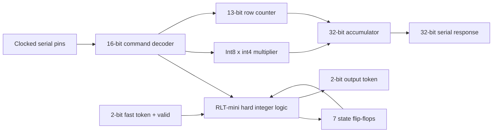

# TapeOut MiniCPM MAC and RLT-mini

**Primary information:** one IHP tile carries an exact streaming signed int8 × int4 MAC and an untrained four-token recurrent toy. Routed-netlist conformance and official GDS precheck pass.

**Required context:** the host supplies MiniCPM operands and nonlinear operations; RLT state stays in seven flip-flops. The synchronous pin protocol below defines exactly when work is accepted and results are read.

**Next action:** connect the host according to the pin map and replay the supplied vectors, starting at 1 MHz. Use the [submission report](../REPORT.md) for the decision on manufacture and its disclosed fanout exception.

Expression: device detail with a relationship diagram and command comparison table.

## How it works

One module contains two independent integer execution blocks sharing a synchronous serial command port. This project demonstrates real MiniCPM5-2B projection arithmetic and an explicitly **untrained structural RLT-mini toy**. It does not place a 2.5 B-parameter model or the published RLT architecture on a tile.

MiniCPM MAC: signed 8-bit activations × signed 4-bit weights produce exact signed 12-bit products accumulated in signed 32 bits. A row sequencer accepts 1–4095 or 6144 terms. MiniCPM's hidden size is 2048, FFN size 6144, query/KV heads 16/2 and head dimension 128. The host supplies quantized operands and applies fixed scaling/RMSNorm/SiLU. All 2048 terms of a real checkpoint-derived Q-projection row match the integer reference. At most 6144 terms bounds the accumulator within ±6,291,456, safely inside 32 bits. This is uniform signed int4 arithmetic, not native GGUF Q4_K_M block decoding.

RLT-mini: four-token vocabulary, two-dimensional binary latent, one causal encoder, one recurrent decoder, two-entry encoder and decoder attention windows, explicit integer Q2 softmax lookup, fixed signed feedforward mixing. Seven state flip-flops carry hidden output, decoder KV, encoder KV and cache validity. The Python reference enumerates all 512 state/input transitions into combinational RTL. Weights and normalization choices are toy fixed constants; no language-model quality is claimed. Fast mode accepts one token/clock. The serial transport takes 16 clocks/token, even though the recurrent transition itself takes one clock.

## Pin interface

All commands use the external `clk`; there is no internal/generated SPI clock and no asynchronous clock crossing. Host changes inputs away from rising edges and samples output before the next rising edge. `rst_n` is synchronous active-low. `ena=0` holds state. Bidirectional pins are configured as outputs; the host must not drive them.

Serial mode `ui[7]=0`: `ui[0]` data input, `ui[1]` active-low frame select, `ui[2]` shift enable. Send 16 bits MSB-first while selected; each enabled rising edge shifts one bit. Raising select aborts any incomplete command or response. It does not clear model state. Commands may be adjacent with select held low.

| Command |16-bit frame|Action|
|---|---|---|
|Clear|0x0000|Clear recurrent state, accumulator, count and error|
|RLT token|0x1000 OR token|Advance one recurrent transition|
|Start row|0x2000 OR length|Clear accumulator and start row; length 0 encodes 6144; 2048 uses 0x2800|
|MAC term|0x3000 OR ((activation&255)<<4) OR (weight&15)|Accept one signed product while busy|
|Read|0x4000|Then clock 32 bits from `uo[3]`, signed accumulator MSB-first|

Other command opcodes are ignored. `uo[0:1]` is the most recent RLT output, `uo[4]` response-active, `uo[5]` MAC-busy, `uo[6]` sticky-done until next start/clear, `uo[7]` error for a MAC sent outside an active row. Starting a new row deliberately discards the prior accumulator. A read pauses command reception for 32 enabled clocks. RLT and MAC state remain independent during interleaved commands.

Fast mode `ui[7]=1`: input token=`ui[1:0]`, valid=`ui[2]`. Every enabled valid rising edge advances RLT and updates output after that edge. Switching to fast mode aborts partial serial framing but retains block state. `uio[6:0]` exposes complete RLT state for conformance/debug.

## How to test

Reset, send clear, and run `test/rlt_tokens.txt`: 1024 tokens with expected complete states/output. Repeat in fast mode and serial mode. For MiniCPM send 0x2800, then all 2048 activation/weight pairs in `test/minicpm_slice.txt`, then 0x4000 and read 32 bits: expected result 41. The vectors derive from actual layer 0 Q projection weights at the pinned official model revision; quantizer/input provenance is in the parent `minicpm/` directory. The activation vector is deterministic synthetic layer input, not a language prompt.

`test/test_models.cpp` also exhausts all 4096 signed operand pairs, accumulates 6144 copies of (-128) × (-8), and checks clear, enable hold and frame abort. Recorded Verilator RTL and routed IHP netlist PASS: 476,379 clock cycles. The routed simulation uses the documented zero-delay PDK adapter in `test/ihp_zero_delay.py`; timing is checked separately by STA. No hardware measurements exist until manufactured silicon is tested.

## External hardware

A microcontroller or FPGA able to drive a synchronous clock/data/select interface. Start at 1 MHz; the project passes post-route timing at 10 MHz across the checked IHP PVT corners. Silicon operation is still unmeasured. A full 2048 term row needs 32832 serial clocks including start/read/result, or 3.2832 ms at 10 MHz. Reference model weights and activations reside on the host.

## Limitations

RLT-mini is a bounded structural toy, not the published full-context RLT or a trained model. MiniCPM execution covers matrix slices with host scheduling and nonlinear operations. Neither a device output nor a GDS file is a BSC proof. Settlement requires replay or a separately validated optimistic/proof protocol. No NEE or #279 block is included in the hardened candidate.
